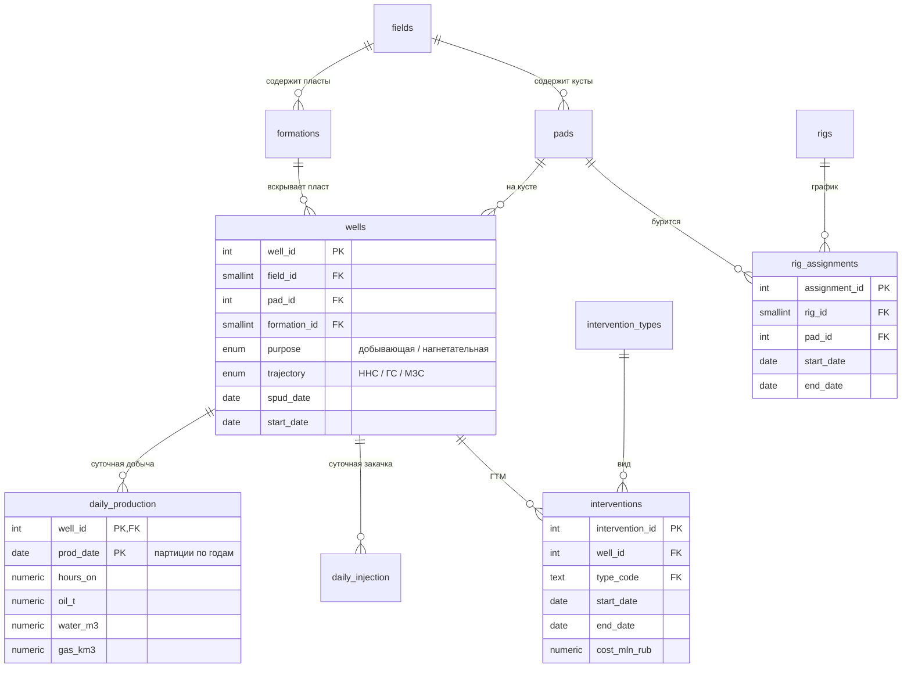

# Oil Production DWH — база данных нефтедобычи

Учебный проект по проектированию баз данных и SQL-аналитике на предметной области
нефтедобычи: месторождения, кусты, скважины, суточная добыча и закачка,
геолого-технические мероприятия (ГТМ) и график буровых установок.

Данные **синтетические**, но сгенерированы по физически осмысленной модели
(падение дебита по Арпсу, рост обводнённости, износ насосов, эффект от ГТМ), поэтому
аналитика даёт правдоподобные отраслевые выводы. Проект поднимается одной командой.

**Стек:** PostgreSQL 16 · ClickHouse 26.8 · Apache Airflow 3.3 · Apache Superset 6.1 · SQL · Python · Docker Compose

```
PostgreSQL (OLTP)  ──►  Airflow DAG  ──►  ClickHouse (DWH, «звезда»)  ──►  Superset (дашборд)
 источник, 3НФ          месяц за месяцем    факты + измерения + витрины     «дашборд как код»
                        со сверкой
```


## Что демонстрирует проект

- **Проектирование схемы** в 3НФ с целостностью на уровне БД: составные внешние ключи,
  `CHECK`, исключающие ограничения `EXCLUDE` (буровая не может стоять на двух кустах
  одновременно, ГТМ на скважине не пересекаются по датам)
- **Партиционирование** таблицы фактов по годам и проверку отсечения партиций
- **Индексы под конкретные сценарии:** BRIN с подобранным `pages_per_range`,
  PK как индекс для точечных выборок, индексы на внешних ключах
- **Материализованное представление** с обновлением без блокировки читателей
- **Аналитический SQL:** оконные функции, `LATERAL`, «острова и пропуски»,
  `ROLLUP` / `GROUPING`, `FILTER`, операции с диапазонами дат
- **Проверки качества данных** для правил, которые не выражаются ограничениями схемы
- **Замеры производительности** через `EXPLAIN ANALYZE` — с честными выводами,
  см. [docs/performance.md](docs/performance.md)
- **Хранилище «звезда» в ClickHouse** и **ETL на Airflow**: идемпотентная загрузка
  с атомарной подменой партиций, backfill истории, сверка с источником до последнего
  знака, сравнение с PostgreSQL — см. [docs/clickhouse.md](docs/clickhouse.md)
- **Дашборд в Superset как код:** подключение, датасеты, метрики, графики, раскладка
  и фильтры создаются скриптом через REST API — см. [docs/superset.md](docs/superset.md)

## Быстрый старт

Нужен только Docker (рекомендуется выделить ему от 6 ГБ памяти).

```bash
git clone https://github.com/Alex91132/oil-production-dwh.git
cd oil-production-dwh
docker compose up -d --build
```

Что произойдёт:
1. PostgreSQL создаёт схему, генератор наполняет её (~30 с, ≈540 тыс. строк добычи).
2. ClickHouse создаёт схему хранилища.
3. Airflow стартует и сам загружает в хранилище всю историю — 69 месячных запусков
   (~3 мин). Ход загрузки — в интерфейсе Airflow: http://localhost:8080.
4. Superset поднимается, и скрипт создаёт дашборд:
   http://localhost:8088/superset/dashboard/oil-production/

Весь стек с нуля готов примерно за 4 минуты.

| Сервис | Адрес | Доступ |
|---|---|---|
| PostgreSQL (источник) | `localhost:5435`, база `oilfield` | `dwh` / `dwh` |
| ClickHouse (хранилище) | `localhost:8123`, база `dwh` | `dwh` / `dwh` |
| Airflow | http://localhost:8080 | без пароля (локальный стенд) |
| Superset | http://localhost:8088 | `admin` / `admin` |

Запустить любой аналитический запрос к источнику:

```bash
docker compose exec db psql -U dwh -d oilfield -f /sql/analytics/04_intervention_effect.sql
```

> В Git Bash на Windows добавьте перед командой `MSYS_NO_PATHCONV=1` — иначе Git Bash
> подменит путь `/sql/...` на путь Windows. В PowerShell и Linux/macOS команда работает как есть.

Запрос к хранилищу:

```bash
docker compose exec clickhouse clickhouse-client -u dwh --password dwh --queries-file /sql/clickhouse/02_intervention_decay_asof.sql
```

Открыть консоль: `docker compose exec db psql -U dwh -d oilfield` или
`docker compose exec clickhouse clickhouse-client -u dwh --password dwh`.
Учётные данные только для локального стенда; меняются в `.env` (см. `.env.example`).

Перегенерировать данные с другим зерном:
`docker compose run --rm generator python generate.py --force --seed 7`

## Модель данных



Ключевые решения:

| Решение | Зачем |
|---|---|
| `field_id` в `wells` + составные FK `(field_id, pad_id)` и `(field_id, formation_id)` | гарантирует, что куст и пласт скважины принадлежат одному месторождению — без триггеров |
| `EXCLUDE USING gist (rig_id WITH =, daterange(...) WITH &&)` | физическое ограничение «одна буровая — один куст» проверяет сама БД |
| `ENUM` для назначения и типа ствола, отдельная таблица для видов ГТМ | стабильные наборы — `ENUM`; справочник с атрибутами (категория, название) — таблица |
| Партиции `daily_production` по годам + `DEFAULT`-партиция | отсечение партиций в запросах за период, простая архивация старых лет |
| Добыча в т, вода в м³, газ в тыс. м³ | единицы, принятые в отраслевой отчётности |

## Аналитические запросы

Каждый файл в [`sql/analytics`](sql/analytics) начинается с бизнес-вопроса и списка
использованных техник. Результаты всех запросов — в
[docs/analytics_results.md](docs/analytics_results.md).

| # | Бизнес-вопрос | Техники SQL |
|---|---|---|
| 01 | Профиль добычи месторождений по годам, доли, накопленная добыча | `LAG`, `SUM OVER`, `WINDOW`, рамка окна |
| 02 | Топ-5 скважин каждого месторождения за 12 месяцев | `RANK() OVER (PARTITION BY)`, топ-N в группе |
| 03 | Среднесуточная добыча, скользящее среднее, изменение год к году | `ROWS BETWEEN`, `LAG(…, 12)`, фильтр после окон |
| 04 | Эффективность ГТМ: прирост, успешность, ₽ за тонну доп. нефти | `LATERAL`, точечные выборки по PK |
| 05 | Скважины с резким ростом обводнённости — кандидаты на РИР | скользящее окно по предыдущим строкам |
| 06 | Простои: плановые и аварийные, недобор нефти | gaps and islands, пересечение `daterange` (`&&`) |
| 07 | Какая доля фонда даёт 50 / 80 / 95 % добычи | накопленная доля, `FILTER`, `VALUES` |
| 08 | Компенсация отборов закачкой | агрегаты на общем зерне, `SUM(SUM()) OVER` |
| 09 | Загрузка и производительность буровых | `LAG` между периодами, `JOIN` по диапазону дат |
| 10 | Фонд скважин на конец каждого года | `generate_series`, коррелированный `EXISTS` |
| 11 | Стартовые дебиты ННС vs ГС vs МЗС | `ROLLUP`, `GROUPING()`, `PERCENTILE_CONT` |

Проверки качества данных — [`sql/checks/01_data_quality.sql`](sql/checks/01_data_quality.sql):
7 правил (добыча до ввода скважины, работа во время ГТМ, бурение вне графика и др.),
на сгенерированных данных все дают 0 нарушений.

## Что показывают данные

- **ЗБС даёт максимальный прирост (+20 т/сут), но тонна доп. нефти у него самая дорогая**
  (~30 тыс. ₽). Самая дешёвая тонна — у ОПЗ (~5,7 тыс. ₽), но он успешен лишь в 57 % случаев;
  ГРП даёт в 4 раза больший прирост при сопоставимой цене тонны (~7,8 тыс. ₽) (запрос 04)
- **Многозабойные скважины на старте дают в 3–4 раза больше наклонно-направленных** —
  на новом месторождении 192 против 61 т/сут (запрос 11)
- **Компенсация отборов:** на зрелых месторождениях перекомпенсация (135–215 %),
  а на растущем «Таёжном» — дефицит закачки (~70 %): нужно больше нагнетательных
  скважин (запрос 08)
- **Добыча держится на меньшинстве фонда:** 11 % скважин дают половину нефти,
  30 % — 80 % (запрос 07)
- **Аварийные простои на новом месторождении стоят дороже всего:** 118 тыс. т
  недобора против 32–45 тыс. т на зрелых — там выше дебиты (запрос 06)
- **Эффект ГРП живёт около года:** дебит удваивается в первый месяц, а к 12-му
  возвращается к исходному уровню; после ОПЗ через год дебит даже ниже исходного
  (ClickHouse, запрос 02 с `ASOF JOIN`)

## Хранилище и загрузка (Этап 2)

Подробно — в [docs/clickhouse.md](docs/clickhouse.md). Коротко:

- **Схема «звезда»:** `dim_well`, `dim_date`, факты суточной добычи, закачки и ГТМ,
  витрина «месторождение × месяц» для дашборда.
- **DAG `oil_dwh_monthly_load`:** один запуск — один месяц. Месяц собирается
  в промежуточной таблице и атомарно подменяет партицию (`REPLACE PARTITION`),
  поэтому повторы и ретраи не создают дублей. После загрузки — сверка с PostgreSQL
  по числу строк и точным суммам.
- **Результат:** 538 437 строк и 13 944 830,318 т нефти — совпадение с источником
  до последнего знака.
- **Сравнение с PostgreSQL:** тяжёлый агрегат в 3–20 раз быстрее (в зависимости от
  `count(DISTINCT)`), хранение в ~5 раз компактнее. Подробные замеры и оговорки —
  в документации.
- **Найденный подвох Airflow 3:** `schedule="@monthly"` по умолчанию даёт запуски
  без интервала данных. Ошибку поймала защита ClickHouse от подмены партиции из
  пустого источника; решено явным `CronDataIntervalTimetable` и проверкой интервала.

## Дашборд (Этап 3)

Подробно — в [docs/superset.md](docs/superset.md). Коротко:

- **8 графиков:** KPI с трендом (добыча, фонд, обводнённость), динамика по
  месторождениям, компенсация отборов, ГТМ по видам и годам, таблица затухания
  эффекта ГТМ. Фильтры по месторождению и периоду.
- **Дашборд как код:** [`superset/bootstrap/create_dashboard.py`](superset/bootstrap/create_dashboard.py)
  создаёт всё через REST API Superset при первом запуске стека; изменения дашборда
  идут через git, а не через клики.
- **Проверено:** значения KPI сверены с прямыми запросами к ClickHouse, фильтры
  применяются ко всем графикам, полный подъём с нуля создаёт дашборд автоматически.
- **Методические детали:** медианы точные (приближённая `median` в ClickHouse давала
  «плавающий» результат); у обводнённости убрано сравнение «+14,5 % к прошлому году»,
  которое легко принять за процентные пункты (на деле +6,4 п.п.).

## Структура проекта

```
oil-production-dwh/
├── docker-compose.yml          # источник, генератор, ClickHouse, Airflow
├── db/
│   ├── Dockerfile
│   └── init/                   # PostgreSQL: выполняется при первом создании БД
│       ├── 01_schema.sql       # таблицы, ограничения, партиции
│       ├── 02_reference_data.sql
│       ├── 03_indexes.sql
│       └── 04_views.sql        # представления и матпредставление
├── generator/
│   ├── Dockerfile
│   └── generate.py             # модель добычи и загрузка через COPY
├── clickhouse/
│   ├── Dockerfile
│   └── init/01_schema.sql      # хранилище: измерения, факты, витрины
├── airflow/
│   ├── Dockerfile
│   └── dags/oil_dwh_monthly_load.py   # ETL PostgreSQL → ClickHouse
├── superset/
│   ├── Dockerfile
│   ├── superset_config.py      # локаль, метаданные, ключ
│   └── bootstrap/create_dashboard.py  # дашборд как код (REST API)
├── sql/
│   ├── analytics/              # 11 аналитических запросов к PostgreSQL
│   ├── checks/                 # проверки качества данных
│   └── clickhouse/             # 4 запроса к хранилищу
├── scripts/
│   ├── run_analytics.py        # прогон всех запросов → docs/*.md
│   └── dashboard_screenshot.py # снимок дашборда → docs/dashboard.png
└── docs/
    ├── performance.md          # замеры EXPLAIN ANALYZE в PostgreSQL
    ├── clickhouse.md           # хранилище, DAG, сверка, сравнение с PostgreSQL
    ├── superset.md             # дашборд, проверка, решённые проблемы
    ├── dashboard.png
    ├── analytics_results.md
    └── analytics_results_clickhouse.md
```

## Дорожная карта

- [x] **Этап 1.** Операционная БД PostgreSQL, генератор данных, SQL-аналитика, замеры производительности
- [x] **Этап 2.** ETL на Apache Airflow → аналитическое хранилище в ClickHouse (схема «звезда»)
- [x] **Этап 3.** Дашборд в Apache Superset («дашборд как код»)

## Об авторе

Александр Федоров — руководитель проектов и аналитик данных, 10+ лет в нефтегазовой
отрасли. Сайт-портфолио: [alex91132.github.io](https://alex91132.github.io)

---

<sub>Все названия месторождений, кустов и подрядчиков вымышлены, данные синтетические.
Совпадения с реальными объектами случайны.</sub>
