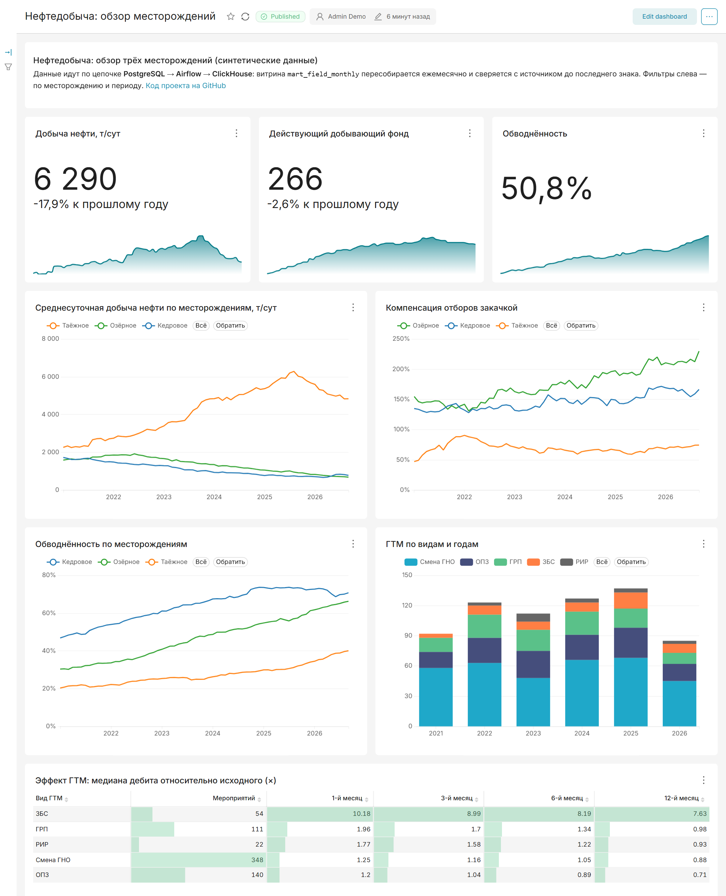

# Этап 3: дашборд в Apache Superset

## «Дашборд как код»

Обычно дашборды в Superset собирают мышкой — их нельзя воспроизвести, а изменения
не видны в истории git. Здесь всё описано в Python:
[`superset/bootstrap/create_dashboard.py`](../superset/bootstrap/create_dashboard.py)
создаёт через REST API подключение к ClickHouse, датасеты с метриками, графики,
раскладку и фильтры. Контейнер `superset-init` запускает скрипт после старта
Superset, поэтому дашборд появляется сам после `docker compose up`.

Скрипт идемпотентен: пересоздаёт дашборд, графики и датасеты с теми же именами.
Изменить дашборд = поправить описание в файле и перезапустить:
`docker compose run --rm superset-init`.

SQL таблицы эффекта ГТМ не продублирован: виртуальный датасет читает тот же файл
[`sql/clickhouse/02_intervention_decay_asof.sql`](../sql/clickhouse/02_intervention_decay_asof.sql),
что и аналитика хранилища.

## Состав

| Блок | Источник | Что показывает |
|---|---|---|
| 3 KPI с трендом | витрина `mart_field_monthly` | добыча нефти т/сут и действующий фонд (с изменением к прошлому году), обводнённость |
| Добыча по месторождениям | витрина | среднесуточная добыча, т/сут |
| Компенсация отборов | витрина | закачка / отбор жидкости |
| Обводнённость по месторождениям | витрина | доля воды в жидкости |
| ГТМ по видам и годам | `fact_interventions` + `dim_well` | число мероприятий, столбцы с накоплением |
| Эффект ГТМ | запрос 02 с `ASOF JOIN` | медиана дебита относительно исходного через 1/3/6/12 мес. |

Метрики заданы в датасете один раз (например, обводнённость —
`sum(water_m3) / sum(liquid_m3)`, взвешенная, а не среднее долей) и переиспользуются
всеми графиками. Цвета месторождений закреплены за названиями и одинаковы на всех
графиках. Фильтры — по месторождению и периоду; к таблице эффекта ГТМ (агрегат по
всей истории) они намеренно не применяются.

Числа и даты — в русской локали (`D3_FORMAT`, `D3_TIME_FORMAT` в
[`superset_config.py`](../superset/superset_config.py)): «6 290», «50,8 %».

## Проверка

- Значения KPI сверены прямым запросом к ClickHouse: 6 290 против 7 660 т/сут
  год назад — −17,9 %; фонд 266 против 273 — −2,6 %.
- Фильтр по месторождению применяется ко всем графикам, включая график ГТМ из
  другого датасета (в него добавлено поле месторождения).
- Полный подъём стека с нуля (`docker compose down -v && docker compose up -d --build`):
  дашборд создаётся автоматически, хранилище загружается за ~4 минуты.

## Что пришлось решить по ходу

| Проблема | Решение |
|---|---|
| Парсер SQL в Superset не понимает `ASOF INNER JOIN` | краткая эквивалентная форма `ASOF JOIN` (результат проверен — идентичен) |
| Приближённая `median` в ClickHouse давала 1,26 вместо 1,25 | точные `medianExactIf` / `quantilesExact` |
| Для доли Superset показывает относительное изменение: обводнённость «+14,5 % к прошлому году» читается как процентные пункты (на деле +6,4 п.п.) | у KPI обводнённости сравнение отключено, оставлен тренд |
| Повторный старт: `create-admin` падает, если администратор уже есть, и обрывает запуск сервера | шаг обёрнут в `( … \|\| true )` |
| Многострочная команда в YAML (`>`) сохраняла переносы у строк с бо́льшим отступом | команда переписана как список аргументов |

## Скриншот

Картинка выше снимается скриптом
[`scripts/dashboard_screenshot.py`](../scripts/dashboard_screenshot.py): headless
Edge/Chrome по протоколу DevTools входит в Superset, ждёт отрисовки всех графиков
и сохраняет снимок. После правок дашборда:
`python scripts/dashboard_screenshot.py`.

## Доступ

http://localhost:8088, логин и пароль `admin` / `admin` (только локальный стенд;
меняются через `SUPERSET_ADMIN_USER` / `SUPERSET_ADMIN_PASSWORD` в `.env`).
Дашборд: http://localhost:8088/superset/dashboard/oil-production/
